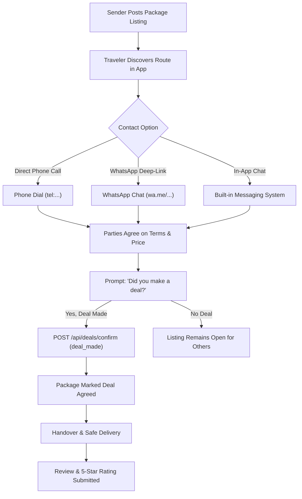

# ✈️ Shantasra

> **Peer-to-Peer Cross-Border Luggage & Package Delivery Marketplace**  
> Connecting package senders with trusted travelers flying on popular international routes to monetize luggage space and provide fast, secure, community-driven delivery.

---

## 📌 Table of Contents

- [Overview](#-overview)
- [Key Features](#-key-features)
  - [For Package Senders](#for-package-senders)
  - [For International Travelers](#for-international-travelers)
  - [Trust & Verification](#trust--verification)
  - [Post-Communication Deal Workflow](#post-communication-deal-workflow)
  - [Admin Control Center](#admin-control-center)
- [Technology Stack](#-technology-stack)
- [Project Architecture & Directory Layout](#-project-architecture--directory-layout)
- [Getting Started & Installation](#-getting-started--installation)
  - [Prerequisites](#prerequisites)
  - [1. Backend Setup (Laravel 13 API & Admin Panel)](#1-backend-setup-laravel-13-api--admin-panel)
  - [2. Frontend Setup (React 19 + Vite + Tailwind CSS)](#2-frontend-setup-react-19--vite--tailwind-css)
  - [3. Database Initialization & Seeding](#3-database-initialization--seeding)
- [Default Seed Credentials](#-default-seed-credentials)
- [API Architecture & Endpoints](#-api-architecture--endpoints)
- [Deal Lifecycle & Agreement Workflow](#-deal-lifecycle--agreement-workflow)
- [Localization](#-localization)
- [Contributing & License](#-contributing--license)

---

## 🌟 Overview

**Shantasra** is a modern peer-to-peer delivery platform designed to solve the high cost, delay, and rigidity of traditional international shipping—specifically across high-traffic diaspora corridors such as the United Arab Emirates (Dubai, Abu Dhabi, Sharjah) and Ethiopia (Addis Ababa).

Instead of waiting weeks for expensive cargo carriers, senders connect directly with verified flyers traveling along the same route. Travelers monetize excess luggage capacity, while senders receive rapid, hand-carried delivery for documents, electronics, gifts, and personal goods.

---

## ✨ Key Features

### For Package Senders
* **Post Delivery Requests**: Publish package requests specifying title, category, weight, declared value, reward/budget, pickup/drop-off locations, and photos.
* **Urgent Delivery Flagging**: Highlight time-critical shipments with priority badges and dedicated filtering.
* **Browse Available Travelers**: Search scheduled traveler itineraries matching your route and target dates.
* **Direct Multi-Channel Contact**:
  * **One-Tap Phone Call**: HTML5 `tel:` dialer integration for direct phone communication.
  * **WhatsApp Deep-Linking**: Instant chat initiation with pre-populated message including package title, route, and weight.
  * **Built-in In-App Chat**: Message travelers directly inside the platform.
* **Package Management Dashboard**: Monitor shipment inquiries, update package details, mark items as inactive, or reactivate anytime.
* **Shareable Deep Links**: Share packages directly via persistent URL query parameters (`?package=:id`).

### For International Travelers
* **Publish Travel Itineraries**: Post departure and destination cities, flight dates, available luggage capacity (kg), and contact details.
* **Luggage Monetization**: Set your preferred rate per kg or negotiated price per item.
* **Custom Route Alerts**: Subscribe to route and category alerts to receive notifications whenever a matching package is posted.
* **Package Browsing & Filtering**: Filter packages by origin city, destination city, category, urgency, and compensation.

### Trust & Verification
* **Government ID Verification**: Senders and travelers upload official ID documents for administrator review and badge issuance.
* **Flight Ticket Verification**: Travelers verify upcoming flights to earn a verified flight badge.
* **Phone Verification**: Authenticated contact badges to reinforce safety.
* **User Reviews & Ratings**: 1-to-5 star rating system with verified deal reviews to build social proof.

### Post-Communication Deal Workflow
* **1-Click Deal Confirmation**: After discussing terms via Phone, WhatsApp, or In-App Chat, users confirm agreements directly on the platform to maintain accurate records.
* **Delivery Confirmation**: Supports formal handshake tracking and status milestones (`open` ➔ `accepted` ➔ `deal_confirmed` ➔ `completed`).

### Admin Control Center
A comprehensive Laravel Blade & Tailwind-powered administration panel (`/admin`):
* **Dashboard & Metrics**: Real-time visibility into users, open shipments, travels, confirmed deals, and inquiries.
* **User Identity Verification**: Review submitted ID documents, approve/reject with contextual notes, and toggle user active status.
* **Shipments & Travels Moderation**: Approve, reject, edit, or archive listings.
* **Email Marketing Campaigns**: Create and send broadcast emails to users with automated unsubscription handling.
* **Package Categories & Subscription Plans**: Full CRUD management for dynamic categories and platform monetization plans.
* **Site Settings Management**: Customize website branding, support contact details, phone numbers, and social links.
* **System Notifications**: Admin notification stream for new registrations, pending approvals, and deal activities.

---

## 🛠 Technology Stack

### Frontend
* **Framework**: [React 19](https://react.dev/)
* **Bundler & Build Tool**: [Vite 8](https://vitejs.dev/)
* **Styling**: [Tailwind CSS v4](https://tailwindcss.com/)
* **Icons**: [Lucide React](https://lucide.dev/)
* **Linting**: [Oxlint](https://oxc.rs/)
* **Internationalization**: Custom lightweight multi-language engine (English, Amharic, Arabic)

### Backend
* **Framework**: [Laravel 13](https://laravel.com/) (PHP 8.3+)
* **Authentication**: [Laravel Sanctum](https://laravel.com/docs/sanctum) (SPA cookie & token authentication) + Multi-guard Admin authentication
* **Templating (Admin)**: Laravel Blade + Tailwind CSS
* **Database & ORM**: MySQL / Eloquent ORM
* **Queue & Cache**: Database drivers with Redis / Memcached support
* **Mailing**: SMTP (configured with Mailtrap for local development)

---

## 📂 Project Architecture & Directory Layout

```
peerbridge-delivery/
├── backend/                     # Laravel 13 API & Admin Backend
│   ├── app/
│   │   ├── Http/
│   │   │   ├── Controllers/
│   │   │   │   ├── Admin/       # Admin panel controllers (Users, Shipments, Campaigns, etc.)
│   │   │   │   └── Api/         # RESTful API endpoints for React SPA
│   │   │   └── Middleware/      # Admin auth, CORS, Sanctum middleware
│   │   └── Models/              # Eloquent models (Shipment, Travel, Booking, Review, etc.)
│   ├── config/                  # Laravel application configurations
│   ├── database/
│   │   ├── migrations/          # Database schema migrations (32 tables & patches)
│   │   └── seeders/             # Database seeders for admin & demo data
│   ├── resources/
│   │   └── views/
│   │       ├── admin/           # Blade views for administrator dashboard
│   │       └── emails/          # Email templates & campaign layouts
│   ├── routes/
│   │   ├── api.php              # Public & Sanctum-protected REST API routes
│   │   ├── web.php              # Admin routes (/admin/...) and unsubscribe links
│   │   └── console.php          # CLI commands and scheduled tasks
│   └── composer.json            # PHP dependencies
│
├── frontend/                    # React 19 Single Page Application
│   ├── src/
│   │   ├── components/          # UI views, cards, modals, navigation, and overlays
│   │   │   ├── HomeView.jsx     # Landing page with hero, search, & featured routes
│   │   │   ├── PackagesView.jsx # Package search, filtering, & detail views
│   │   │   ├── TravelersView.jsx# Traveler listing and flight route directory
│   │   │   ├── DashboardView.jsx# User portal for active packages, trips, & deals
│   │   │   ├── PhoneContactModal.jsx # Direct phone & WhatsApp connect modal
│   │   │   └── DealConfirmationModal.jsx # 1-click deal confirmation modal
│   │   ├── context/             # React contexts (SiteSettings, Auth, etc.)
│   │   ├── data/                # Initial fallback mock data and translation dictionaries
│   │   ├── lib/                 # HTTP API client utility
│   │   ├── App.jsx              # Main application router and state coordinator
│   │   └── main.jsx             # React DOM entry point
│   ├── vite.config.js           # Vite dev proxy configuration (`/api`, `/storage`)
│   └── package.json             # Frontend dependencies & scripts
│
├── peerbridge_deal_workflow_guide.md # Deal workflow documentation
├── peerbridge_delivery.sql      # Pre-generated complete SQL database dump
└── README.md                    # Project documentation
```

---

## 🚀 Getting Started & Installation

### Prerequisites
Make sure your development machine has the following installed:
* **PHP**: `>= 8.3` (with `pdo`, `mbstring`, `openssl`, `tokenizer`, `xml`, `ctype`, `curl` extensions)
* **Composer**: `>= 2.7`
* **Node.js**: `>= 20.x` & **npm**: `>= 10.x`
* **MySQL**: `>= 8.0` (or MariaDB)

---

### 1. Backend Setup (Laravel 13 API & Admin Panel)

1. Open a terminal and navigate into the `backend` directory:
   ```bash
   cd backend
   ```

2. Install PHP dependencies:
   ```bash
   composer install
   ```

3. Configure your environment file:
   ```bash
   cp .env.example .env
   ```

4. Generate the application encryption key:
   ```bash
   php artisan key:generate
   ```

5. Create your database (e.g. `peerbridge_delivery` in MySQL) and update database credentials in `.env`:
   ```env
   DB_CONNECTION=mysql
   DB_HOST=127.0.0.1
   DB_PORT=3306
   DB_DATABASE=peerbridge_delivery
   DB_USERNAME=your_mysql_username
   DB_PASSWORD=your_mysql_password
   ```

6. Ensure CORS and Sanctum domains are configured for the frontend:
   ```env
   APP_URL=http://localhost:8000
   FRONTEND_URL=http://localhost:5173
   SANCTUM_STATEFUL_DOMAINS=localhost:5173,127.0.0.1:5173,localhost:8000,127.0.0.1:8000
   CORS_ALLOWED_ORIGINS=http://localhost:5173,http://127.0.0.1:5173
   ```

7. Link public storage for image uploads (package pictures, user avatars, ID documents):
   ```bash
   php artisan storage:link
   ```

8. Run migrations and seed the database (or see database import options below):
   ```bash
   php artisan migrate --seed
   ```

9. Install backend Vite dependencies (used for the Admin panel styling) and compile:
   ```bash
   npm install
   npm run build
   ```

10. Start the Laravel backend server:
    ```bash
    php artisan serve --port=8000
    ```
    * Backend API will run on `http://127.0.0.1:8000`
    * Admin Panel will be accessible at `http://127.0.0.1:8000/admin`

---

### 2. Frontend Setup (React 19 + Vite + Tailwind CSS)

1. In a new terminal window, navigate into the `frontend` directory:
   ```bash
   cd frontend
   ```

2. Install Node dependencies:
   ```bash
   npm install
   ```

3. Verify `vite.config.js` proxy settings:
   The frontend is pre-configured to proxy `/api`, `/sanctum`, and `/storage` requests to `http://127.0.0.1:8000`.

4. Start the Vite development server:
   ```bash
   npm run dev
   ```
   * The client application will be available at `http://localhost:5173`

---

### 3. Database Initialization & Seeding

You can initialize the database using either of the following two methods:

#### Option A: Laravel Migrations & Seeders (Recommended)
```bash
cd backend
php artisan migrate:fresh --seed
```
This runs all 32 migration files and seeds package categories, subscription tiers, sample users, demo shipments, and the administrator profile.

#### Option B: Direct SQL Import
A complete SQL snapshot is included in the project root (`peerbridge_delivery.sql`). You can import it directly via MySQL CLI:
```bash
mysql -u your_mysql_username -p peerbridge_delivery < peerbridge_delivery.sql
```

---

## 🔐 Default Seed Credentials

### Platform Administrator
* **URL**: `http://localhost:8000/admin/login`
* **Email**: `admin@peerbridge.test`
* **Password**: `password`

### Test Users
The database seeder provisions sample sender and traveler accounts (e.g., `Mimi Tesfaye`, `Hana Mekonnen`, `Samrawit Bekele`) with password `password`.

---

## 📡 API Architecture & Endpoints

All client communication is served via JSON endpoints under `/api`.

### Public Endpoints
| Method | Route | Description |
| :--- | :--- | :--- |
| `POST` | `/api/register` | Register new user account |
| `POST` | `/api/login` | Authenticate existing user |
| `POST` | `/api/forgot-password` | Send password reset token/email |
| `POST` | `/api/reset-password` | Update password with token |
| `GET` | `/api/shipments/open` | Fetch active, approved shipments with filters |
| `GET` | `/api/shipments/urgent` | Fetch urgent / prioritized shipments |
| `POST` | `/api/shipments/{id}/inquire` | Increment and log user inquiry on a package |
| `GET` | `/api/travelers` | Browse upcoming traveler flight itineraries |
| `GET` | `/api/package-categories` | List active package categories |
| `GET` | `/api/site-settings` | Fetch platform branding & contact configurations |

### Authenticated Endpoints (`auth:sanctum`)
| Method | Route | Description |
| :--- | :--- | :--- |
| `GET` | `/api/user` | Get current authenticated user profile |
| `PATCH` / `POST` | `/api/user` | Update profile, avatar, or submit ID document |
| `POST` | `/api/logout` | Invalidate authenticated session |
| `GET` | `/api/shipments` | Get current user's posted shipments |
| `POST` | `/api/shipments` | Create a new delivery request (supports multipart images) |
| `PUT` / `POST` | `/api/shipments/{id}` | Update existing shipment |
| `POST` | `/api/shipments/{id}/reactivate` | Reactivate an inactive shipment |
| `DELETE` | `/api/shipments/{id}` | Delete a shipment |
| `POST` | `/api/travels` | Create a new travel itinerary |
| `GET` | `/api/travels/mine` | List current user's posted trips |
| `GET` | `/api/conversations` | List user chat conversations |
| `POST` | `/api/conversations/start` | Start chat conversation with a sender/traveler |
| `POST` | `/api/conversations/{id}/messages`| Send a message within a conversation |
| `GET` | `/api/deals/mine` | List user's deals and confirmations |
| `POST` | `/api/deals/confirm` | Record a deal confirmation (`deal_made` or `no_deal`) |
| `GET` | `/api/reviews/mine` | List reviews received by current user |
| `POST` | `/api/reviews` | Submit rating & review for a shipment/user |
| `GET` | `/api/package-alerts` | List configured route alerts & notifications |
| `POST` | `/api/package-alerts` | Subscribe to route/category notifications |
| `PATCH` | `/api/package-alerts/{id}/toggle` | Toggle alert active state |
| `DELETE` | `/api/package-alerts/{id}` | Remove route alert |

---

## 🤝 Deal Lifecycle & Agreement Workflow



---

## 🌍 Localization

Shantasra includes built-in multi-language support for:
- 🇺🇸 **English** (`en`)
- 🇪🇹 **Amharic** (`am` - አማርኛ)
- 🇦🇪 **Arabic** (`ar` - العربية)

Language switching is accessible via the top-right header selector (`LanguageSelector.jsx`), with all key terminology, buttons, validation alerts, and navigation labels translated in `frontend/src/data/translations.js`.

---

## 🛡️ Security & Quality Standards

- **Cross-Site Request Forgery (CSRF)**: Protected via Laravel Sanctum stateful cookie authentication.
- **Input Validation**: Dedicated Form Request validation across all API endpoints and Admin controllers.
- **SQL Injection Prevention**: Eloquent ORM parameterized queries.
- **File Upload Protection**: Validated mime-types and size boundaries on package pictures and identity documents stored securely in `storage/app/public`.
- **Admin Isolation**: Dedicated `admin` authentication guard preventing privilege escalation.

---

## 📄 Contributing & License

1. Fork the Project.
2. Create your Feature Branch (`git checkout -b feature/AmazingFeature`).
3. Commit your Changes (`git commit -m 'feat: Add AmazingFeature'`).
4. Push to the Branch (`git push origin feature/AmazingFeature`).
5. Open a Pull Request.

Distributed under the **MIT License**.
