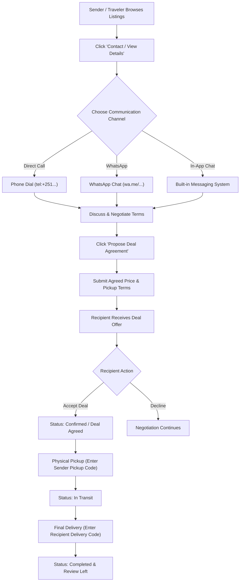

# Shantasra: Package Sender & Traveler Deal Workflow Guide

This document outlines the complete architectural design, database schemas, API endpoints, and step-by-step user interaction workflow for connecting **Package Senders** and **Travelers**, facilitating direct contact, and managing deal agreements after they communicate.

---

## 1. Executive Summary & Communication Flow

Connecting package senders and travelers involves two primary phases:

1. **Initial Contact & Discovery**: Senders and travelers discover route listings and initiate direct communication via Phone call (`tel:`), WhatsApp link, or In-App Chat.
2. **Post-Call Deal Agreement & Lifecycle**: Once both parties agree on price, weight, and handover details over the phone/chat, the platform locks in the deal, tracks package handover, verifies delivery with secure 4-digit codes, and collects reviews.



---

## 2. Communication Modes (Contact Details)

### 2.1 Direct Phone Call & WhatsApp Integration
When a user views a listing detail card, the app presents options to connect immediately:

* **Direct Phone Link**: Standard HTML5 `tel:` protocol allowing mobile browsers to launch dialers automatically.
* **WhatsApp Deep Link**: Pre-filled contextual text passing package title, weight, and route:
  ```
  https://wa.me/251911223344?text=Hi%20Alex%2C%20I%20am%20reaching%20out%20regarding%20your%20route%20from%20Dubai%20to%20Addis%20Ababa%20on%20Shantasra.
  ```

---

## 3. The 4-Step Deal Agreement & Status Lifecycle

> [!IMPORTANT]
> A phone call alone is unrecorded. To guarantee trust, safety, and operational tracking, the platform requires one party to formally register the agreed terms in the system after talking.

### Step 1: Propose Deal Agreement (Offer Creation)
After negotiating via phone/WhatsApp, either party clicks **"Finalize Deal / Propose Agreement"** inside the app.

**Form Inputs**:
* Agreed Price (e.g., `$40` total or `$10/kg`)
* Estimated Pickup Date & Location
* Package ID & Traveler Route ID

**System Behavior**:
* Creates a `Booking` record with `status = 'pending_agreement'`.
* Triggers an in-app notification & email to the counterparty.

---

### Step 2: Mutual Confirmation (Locking the Deal)
The receiving party receives an alert:
> *"Traveler Alex proposed a delivery deal of $40 for package 'Electronics to Addis Ababa'. Review and accept."*

* **Accept**: `booking.status` becomes `confirmed`, `shipment.status` becomes `accepted` (package is reserved).
* **Decline**: Notification sent back; package remains open for other travelers.

---

### Step 3: Handover & Pickup Verification Code
To prevent fraudulent claims that a package was never handed over:
1. The **Sender** sees a 4-digit **Pickup Code** (e.g., `4812`) in their active dashboard.
2. At physical meeting time, the **Traveler** inspects the package, asks the sender for the code, and inputs it in their app.
3. Upon code match, `shipment.status` automatically advances to **`in_transit`**.

---

### Step 4: Final Delivery Code & Rating Review
1. Upon arriving at destination city, the traveler meets the **Recipient**.
2. The recipient provides their 4-digit **Delivery Code** (sent via SMS/App).
3. Traveler inputs the delivery code.
4. **System Action**:
   * `booking.status` -> `completed`
   * `shipment.status` -> `delivered`
   * Opens the **Rating & Review Modal** for mutual feedback (1–5 stars).

---

## 4. Database Schema Specification

```sql
-- Bookings Table Schema
CREATE TABLE IF NOT EXISTS `bookings` (
  `id` BIGINT UNSIGNED AUTO_INCREMENT PRIMARY KEY,
  `shipment_id` BIGINT UNSIGNED NOT NULL,
  `travel_id` BIGINT UNSIGNED NOT NULL,
  `sender_id` BIGINT UNSIGNED NOT NULL,
  `traveler_id` BIGINT UNSIGNED NOT NULL,
  `agreed_price` DECIMAL(10,2) NOT NULL,
  `pickup_location` VARCHAR(255) NULL,
  `pickup_code` VARCHAR(6) NULL,
  `delivery_code` VARCHAR(6) NULL,
  `status` ENUM('pending_agreement', 'confirmed', 'in_transit', 'completed', 'cancelled') DEFAULT 'pending_agreement',
  `created_at` TIMESTAMP NULL DEFAULT CURRENT_TIMESTAMP,
  `updated_at` TIMESTAMP NULL DEFAULT CURRENT_TIMESTAMP ON UPDATE CURRENT_TIMESTAMP,
  FOREIGN KEY (`shipment_id`) REFERENCES `shipments`(`id`) ON DELETE CASCADE,
  FOREIGN KEY (`travel_id`) REFERENCES `travel`(`id`) ON DELETE CASCADE,
  FOREIGN KEY (`sender_id`) REFERENCES `users`(`id`) ON DELETE CASCADE,
  FOREIGN KEY (`traveler_id`) REFERENCES `users`(`id`) ON DELETE CASCADE
) ENGINE=InnoDB DEFAULT CHARSET=utf8mb4;
```

---

## 5. API Endpoint Architecture

| Method | Endpoint | Description |
| :--- | :--- | :--- |
| `POST` | `/api/bookings/propose` | Submits proposed deal terms after phone/chat discussion. |
| `POST` | `/api/bookings/{booking}/accept` | Accepts deal; locks shipment status to `accepted`. |
| `POST` | `/api/bookings/{booking}/verify-pickup` | Validates 4-digit pickup code; updates status to `in_transit`. |
| `POST` | `/api/bookings/{booking}/verify-delivery` | Validates 4-digit delivery code; updates status to `completed`. |

---

## 6. Summary Table of User Actions

| Action Stage | User Action | System Outcome |
| :--- | :--- | :--- |
| **Browsing** | Clicks `Call Now` or `WhatsApp` | Direct phone call or pre-filled WhatsApp message |
| **Post-Call** | Clicks `Propose Agreement` | Creates pending booking with agreed price & location |
| **Deal Confirmation** | Recipient clicks `Accept Deal` | Locks shipment & prevents duplicate bookings |
| **Package Handover** | Traveler inputs `Pickup Code` | Status changes to **In Transit** |
| **Final Delivery** | Traveler inputs `Delivery Code` | Status changes to **Completed** & opens Review Form |

---
*Documented for Shantasra Platform.*
