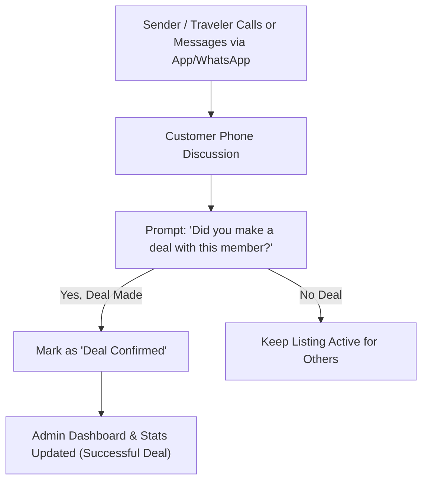

# Shantasra: Simple Deal Confirmation Guide

This simplified guide focuses exclusively on **verifying if a sender and traveler made a deal** after communicating. Delivery verification is handled by the customers themselves—the platform only tracks whether a deal was confirmed.

---

## 1. Simple Concept & Workflow



---

## 2. Simple 2-Step Deal Confirmation Flow

### Step 1: Phone / WhatsApp Discussion
* Senders and travelers connect via standard call or WhatsApp.
* They negotiate price and pickup details directly between themselves.

### Step 2: "Did You Make a Deal?" Prompt
After contacting a member, a simple popup or banner appears on their dashboard:

> **"Did you agree on a deal with Alex for package 'Laptop to Addis'?"**
> 
> `[ Yes, We Made a Deal ]` &nbsp;&nbsp;&nbsp;&nbsp; `[ No / Still Talking ]`

#### Option A: Click "Yes, We Made a Deal"
* **Inputs (Optional)**: Agreed price (e.g. `$30`).
* **System Action**:
  * Sets status to `deal_confirmed`.
  * Increments platform deal count for Admin Dashboard stats.
  * Marks the package as **Deal Agreed**.

#### Option B: Click "No Deal"
* The listing remains open for other members to contact.

---

## 3. Minimal Database Table (`deal_confirmations`)

If you want a lightweight table to store deal confirmations:

```sql
CREATE TABLE IF NOT EXISTS `deal_confirmations` (
  `id` BIGINT UNSIGNED AUTO_INCREMENT PRIMARY KEY,
  `shipment_id` BIGINT UNSIGNED NOT NULL,
  `traveler_id` BIGINT UNSIGNED NOT NULL,
  `sender_id` BIGINT UNSIGNED NOT NULL,
  `agreed_price` DECIMAL(10,2) NULL,
  `status` ENUM('deal_made', 'no_deal') DEFAULT 'deal_made',
  `created_at` TIMESTAMP NULL DEFAULT CURRENT_TIMESTAMP,
  FOREIGN KEY (`shipment_id`) REFERENCES `shipments`(`id`) ON DELETE CASCADE
);
```

---

## 4. Minimal API Endpoint

```php
// POST /api/deals/confirm
{
    "shipment_id": 5,
    "traveler_id": 12,
    "status": "deal_made", // or "no_deal"
    "agreed_price": 30.00
}
```

---

## 5. Summary

* **No delivery tracking needed**: Customers manage physical delivery themselves.
* **1-Click Deal Confirmation**: Senders and travelers simply confirm with one click if they made a deal after talking.
* **Platform Visibility**: Platform admins get accurate counts of successful deals made on the site.
